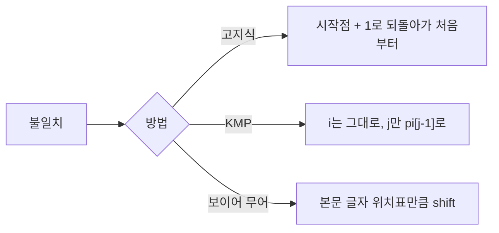

본문(t) 안에서 패턴(p)이 어디 있는지 찾기. N = 본문 길이, M = 패턴 길이
- 고지식한 방법: 한 칸씩 밀며 처음부터 비교. O(MN)
- KMP: 패턴 안에서 반복되는 정보(pi 테이블)로 건너뛰기. O(M + N)
- 보이어 무어: 패턴 뒤에서부터 비교하고, 틀린 본문 글자를 보고 크게 건너뛰기. 보통 O(N) 미만



### 고지식한 방법 (brute force)
- 틀렸을 때의 정보를 안 쓰고 무작정 한 칸씩만 이동. 비효율 ([[완전_검색]])
- 불일치면 i를 이번 비교 시작점(`i - j`)으로, j를 -1로 두고 아래에서 둘 다 +1. 결과적으로 시작점 + 1, 패턴 처음부터
- j가 M이 되면 다 일치. i는 마지막 일치 뒤 +1된 상태라 시작 인덱스는 `i - M`
```python
def BruteForce(p, t):
    N = len(t)
    M = len(p)
    i = 0  # 본문 인덱스
    j = 0  # 패턴 인덱스
    while j < M and i < N:
        if t[i] != p[j]:
            i = i - j  # 비교 시작점 (아래 +1로 시작점 + 1)
            j = -1     # 아래 +1로 0
        i = i + 1
        j = j + 1
    if j == M:
        return i - M   # 검색 성공
    else:
        return -1      # 검색 실패
```

### KMP
- 패턴 자체의 반복 정보를 씀. ABABAB면 AB 묶음이 반복
- LPS(pi 테이블): 패턴의 각 위치까지에서 앞뒤가 같은 가장 긴 길이. 본문과 불일치하면 이만큼 살려두고 이어서 비교
- 만드는 법 (투 포인터): i는 패턴을 끝까지 훑으며 기록, 1부터. j는 지금까지 일치한 접두사 길이이자 다음에 비교할 인덱스, 0부터
  1. i를 전진시키며 `pattern[i]`와 `pattern[j]` 비교
  2. 일치하면 j를 1 늘려 `lps[i] = j`
  3. 불일치하면 j를 `lps[j-1]`로 되돌려 다시 비교. 0이 아니라 `lps[j-1]`인 이유: 직전까지 맞았던 덩어리 안에 맨 앞과 똑같이 생긴 작은 덩어리가 또 있는지 확인. 반복 연산을 피하려는 것

예: 패턴 AABAAA

| i | 글자 | j | 비교 | lps[i] | j의 움직임 |
|---|---|---|---|---|---|
| 0 | A | 0 | (첫 글자) | 0 | 시작점 |
| 1 | A | 0 | A == A | 1 | j가 1로 |
| 2 | B | 1 | B != A | 0 | j가 lps[0] = 0으로 후퇴 |
| 3 | A | 0 | A == A | 1 | j가 1로 |
| 4 | A | 1 | A == A | 2 | j가 2로 |
| 5 | A | 2 | A != B | 2 | j가 lps[1] = 1로 후퇴 → pattern[1](A)와 일치 → j = 2 |

- 본문 인덱스 i는 한 번 커지면 다시 작아지지 않음
```python
def KMP_search(t, p):
    def get_pi(pattern):  # 1. 패턴 분석
        m = len(pattern)
        pi_table = [0] * m
        j = 0  # 접두사 인덱스
        for i in range(1, m):  # 접미사 인덱스
            while j > 0 and pattern[i] != pattern[j]:
                j = pi_table[j - 1]  # 이전에 일치했던 위치로
            if pattern[i] == pattern[j]:
                j += 1
                pi_table[i] = j
        return pi_table

    n = len(t)  # 2. 검색
    m = len(p)
    pi = get_pi(p)
    j = 0
    for i in range(n):  # i는 전진만
        while j > 0 and t[i] != p[j]:
            j = pi[j - 1]  # 중복되는 앞부분으로 점프
        if t[i] == p[j]:
            if j == m - 1:
                return i - m + 1  # 패턴 시작 인덱스
            else:
                j += 1
    return -1
```
- 예: `KMP_search("ABC ABCDAB ABCDABCDABDE", "ABCDABD")`

### 보이어 무어
- 반복을 줄이는 건 같고, 패턴 뒤에서부터 비교
  1. 패턴 맨 끝 위치의 본문 글자가 패턴 안에 없으면 패턴 길이만큼 shift
  2. 다르지만 패턴 안에 있으면 (패턴 길이 - 1 - 그 글자의 index)만큼 shift. 패턴 water, 본문 글자 e: e는 index 3이라 1칸 밀어야 겹침
  3. 맨 끝 글자가 같으면 바로 앞 글자 비교
- 나쁜 문자(bad character): 비교하다 패턴과 다른 본문 글자. 이 글자가 패턴 안에 여럿이면(패턴 ANANAS에 본문 A) 불일치 지점보다 왼쪽에 있으면서 가장 오른쪽에 있는 것에 맞춤. 정답을 건너뛰지 않게 가장 조금 shift
- 위치표는 루프 밖에서 역순 dict로 한 번만: `{char: (p_end - i) for i, char in enumerate(p)}`. 같은 글자가 여럿이면 뒤에 나온 것이 덮어써서 가장 오른쪽 기준이 됨 ([[S4864_문자열_비교]], [[룩업_테이블]])
- 위치표 값이 0(패턴 맨 끝 글자)이면 shift가 안 늘어 무한 루프. 0일 때는 1칸 ([[S4864_문자열_비교]])
- shift 상한은 `len(t) - len(p)`. len(t)로 잡으면 `t[shift + p_end]`에서 인덱스 에러, 답이 나올 수 없는 구간까지 검사 ([[S4864_문자열_비교]])
- 시간: 보통 O(N) 미만, 최선 O(N/M), 최악은 고지식한 방법과 같은 O(MN)
- 구현 코드는 [[S4864_문자열_비교]]

관련: [[문자열_처리]], [[완전_검색]], [[룩업_테이블]]
