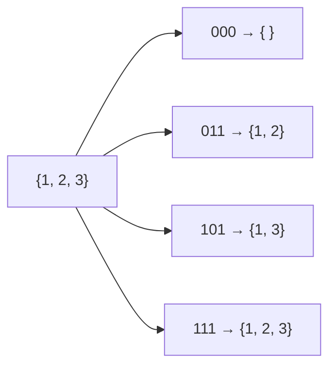

완전 검색, 고지식한 방법(brute force). 가능한 모든 경우를 만들어 하나씩 다 확인
- 먼저 완전 검색으로 풀어보고, 그다음 다른 알고리즘으로 성능 개선
- 순서대로 다 보는 순차 검색, 모든 부분집합·순열·조합을 만드는 [[백트래킹]], 패턴을 한 칸씩 밀어보는 [[문자열_패턴_매칭]]의 brute force가 모두 여기에 속함


원소마다 있다 / 없다를 비트 하나로. 원소 3개면 2³ = 8가지 (일부만 그림)

### 시작
- 언제: N이 작아 모든 경우를 봐도 시간 안에 들어올 때 ([[시간_복잡도_추정]])
- 부분집합의 합: 유한한 정수 집합에서 합이 0이 되는 부분집합 찾기. (-7, -3, -2, 5, 8) → (-3, -2, 5) ([[S13675_부분집합의_합]], [[S4837_부분집합의_합]])
- 부분집합 개수 = 2^(원소 수). 원소가 있다 / 없다의 0 / 1 비트 문제로 바꿀 수 있음. 이때 비트 자리가 index 역할
- 원소 수만큼 for를 겹치고 `in` / `not in`으로 고르는 방식은 비효율

### 진행
- 비트로 부분집합 만들기: `1 << n`이 2ⁿ이라 i가 0 ~ 2ⁿ-1을 돌면 모든 부분집합. `i & (1 << j)`가 0이 아니면 j번째 원소 포함
```python
full_list = [1, 2, 3, 4, 5, 6, 7, 8, 9, 10]
n = len(full_list)
for i in range(1 << n):          # 전체 부분집합 개수만큼
    subset = []
    for j in range(n):
        if i & (1 << j):         # i의 j번째 비트가 1이면
            subset.append(full_list[j])
```
- 예: n = 5, i = 3(이진수 11). j = 0이면 11 & 01 = 01(True), j = 1이면 11 & 10 = 10(True), j = 2~4는 00(False) → full_list[0], full_list[1]만 뽑힘
- `&`는 같은 자리가 둘 다 1이어야 1. if는 0만 아니면 True
- 시프트 `<<`, `>>`는 비트를 다른 자릿수로 옮김. 2진수라 한 칸 옮기면 2를 곱하거나 나누는 것과 같음
- 비트 연산은 숫자를 0 / 1 배열로 보고 같은 자리 비트끼리 계산. 로우레벨이라 메모리 친화적

### 순차 검색 / 순회
- 2중 for가 기본. 방향에 따라 행 우선, 열 우선, 지그재그 ([[격자_좌표_처리]])
- 정렬돼 있으면 key를 넘어선 순간 멈출 수 있음. 그래도 O(N) ([[이진_탐색]])

### 종료
- 모든 경우를 다 봤으면 끝. 답이 하나면 찾자마자 종료 ([[백트래킹]])

관련: [[백트래킹]], [[문자열_패턴_매칭]], [[이진_탐색]]
