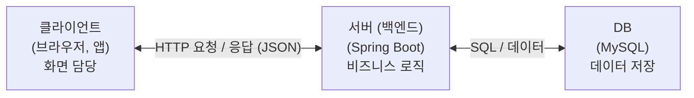
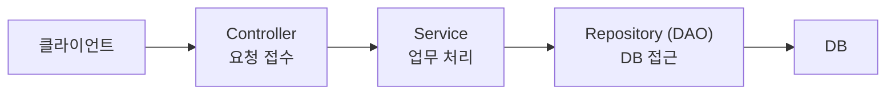
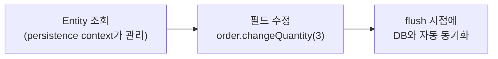
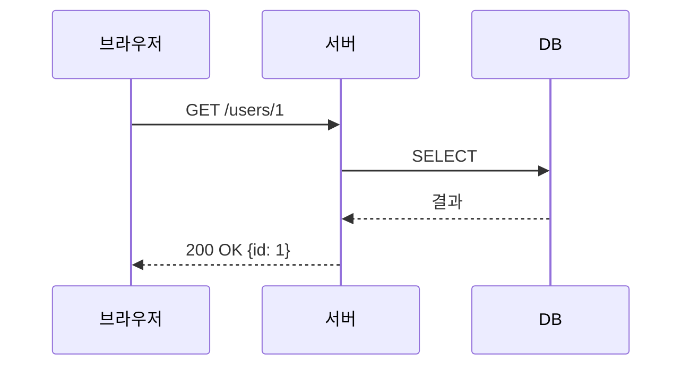
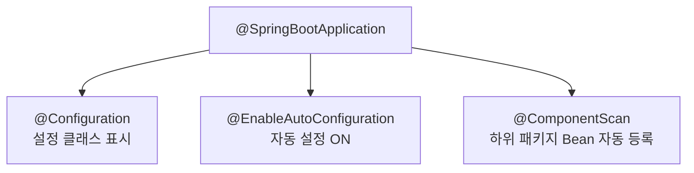
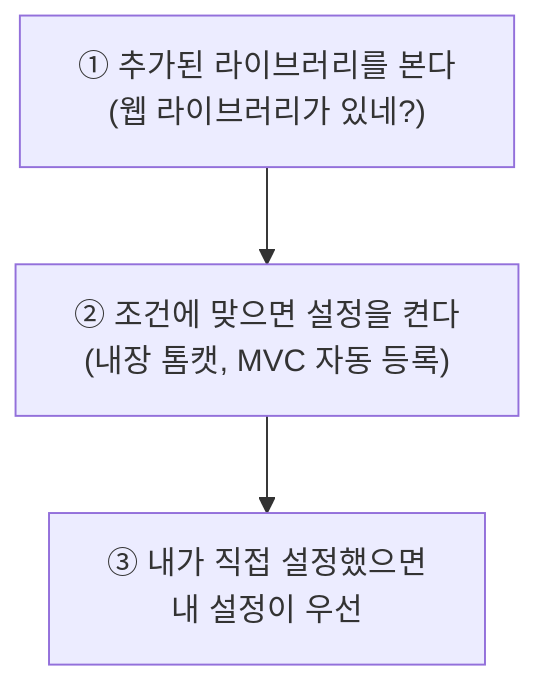

2026.09.29 (화) 저녁 8시 (비대면)

### 1. 백엔드 큰 그림

#### 1.1. 웹 서비스 3계층



| 덩어리          | 하는 일                                  | 예                  |
| ------------ | ------------------------------------- | ------------------ |
| **클라이언트**    | 화면을 보여주고, 사용자의 행동을 요청으로 바꿔 보냄         | 웹 브라우저, 모바일 앱      |
| **서버 (백엔드)** | 요청을 규칙대로 처리하고 DB와 대화 -> **우리가 만들 부분** | Spring Boot 애플리케이션 |
| **DB**       | 데이터를 저장하고 꺼내 줌                        | MySQL              |
**왜 서버를 사이에 둘까 (클라이언트가 DB에 직접 접근하면)**
- 보안: 클라이언트마다 DB 계정 정보를 가져야 하고, 앱 안에 비밀번호가 들어가면 누구나 꺼내 볼 수 있음
- 로직 중복: 검증, 계산 같은 규칙을 웹, 안드로이드, iOS가 각자 구현해야 함 (하나 고치면 셋 다 고쳐야 함)
- 결합: DB 구조가 바뀌면 모든 클라이언트 코드를 같이 수정해야 함

#### 1.2. 서버(백엔드) 쪼개기
서버 코드는 클라이언트부터 DB까지 역할별로 나눈 층으로 설계



| 층 | 역할 | 비유 (식당) |
|---|---|---|
| Controller | 클라이언트와 **직접 만나는 입구**. HTTP 요청을 받고 응답을 돌려줌. 업무는 Service에 넘김 | 홀 직원 (주문 받기, 음식 내기) |
| Service | **비즈니스 로직**(업무 규칙) 처리. "무엇을 어떤 순서로 할지" | 요리사 (레시피대로 조리) |
| Repository (DAO) | DB 읽기/쓰기만 담당 (SQL, JPA) | 창고 담당 (재료 꺼내고 넣기) |

- 비즈니스 로직 = 서비스의 규칙. 예를 들어 재고가 있어야 주문 가능하다.
- 위층이 아래층을 호출함 (Controller -> Service -> Repository)
- 역으로는 호출하지 않음 (Return값 받는다)
  
- 왜 나누나
    - 한 층만 바꾸면 됨: DB를 바꿔도 Service는 그대로, 응답 형식을 바꿔도 Repository는 그대로
    - 테스트와 재사용이 쉬움: Service만 따로 테스트, 같은 Service를 여러 Controller가 사용
    - 층끼리는 인터페이스로 연결되고 DI로 주입됨 ([[Basics_W2]], [[Basics_W3]])
- 이 층 구조를 웹 화면 기준으로 부르는 이름이 MVC -> [[Basics_W4]]

#### 1.3. 역할 층 사이를 오가는 객체: DTO, Entity, VO, DAO
층이 나뉘면 층 사이에서 **데이터를 담아 옮기는 객체**가 필요함

| 이름 | 한 줄 정리 | 쓰이는 곳 | 예 |
|---|---|---|---|
| **DTO** (Data Transfer Object) | 데이터를 **옮기기만** 하는 객체. 로직 없음 | 클라이언트 <-> Controller <-> Service | `OrderRequest`(요청), `OrderResponse`(응답) |
| **Entity** | **DB 테이블 한 행**과 1:1로 대응하는 객체 | Service <-> Repository <-> DB | `Order`, `Member` |
| **VO** (Value Object) | **값 그 자체**를 나타내는 객체. 불변, 값이 같으면 같은 것 | 어디서든 | `Money(1000원)`, `Address` |
| **DAO** (Data Access Object) | 데이터를 담는 객체가 아니라 **DB에 접근하는 일을 하는 객체**. 위 세 개와 달리 층 사이를 오가는 데이터가 아님 | Repository 층 | `OrderRepository` |

```java
public record OrderRequest(String productName, int quantity) { }      // DTO: 요청 모양

public class Order {                                                  // Entity: DB 행 모양
    private Long id;
    private String productName;
    private int quantity;
    private int totalPrice;
    // ...
}

public record Money(int amount) { }                                   // VO: 값 자체 (불변, 같은 값이면 같은 것)
```

**헷갈리는 쌍**

| 쌍                                                                                 | 앞                                                            | 뒤                                                          |
| --------------------------------------------------------------------------------- | ------------------------------------------------------------ | ---------------------------------------------------------- |
| DTO vs Entity                                                                     | **DTO**: 밖과 주고받는 요청/응답 모양                                    | **Entity**: DB 행에 맞춘 모양. id가 테이블의 기본키(PK)에 대응 (예: `Order`) |
| DTO vs VO                                                                         | **DTO**: 데이터를 옮기는 용도 (예: `OrderRequest`)                     | **VO**: 값 표현하려고 만듦. 값이 모두 같으면 같은 것, 불변 (예: `Money`)        |
| Entity vs VO                                                                      | **Entity**: id(정체성)가 같으면 같은 것. 값이 바뀌면 같은 객체의 상태가 바뀜 (id 그대로) | **VO**: 값이 모두 같으면 같은 것. 값이 바뀌면 새 객체로 교체                    |
| DTO vs DAO                                                                        | **DTO**: 데이터를 담는 객체                                          | **DAO**: DB 접근 일을 하는 객체                                    |
| DAO vs Repository<br>(둘은 같은 말이 아님, 편의상 DB 접근 층의 의미로 묶어 부르기도 함 ex. Repository/DAO) | **DAO**: 전통 Jakarta EE 패턴, 데이터 접근 담당                         | **Repository**: DDD 패턴, 도메인 객체를 컬렉션처럼 다룸.                  |
| Service vs Repository/DAO                                                         | **Service**: 업무 규칙                                           | **Repository/DAO**: DB 접근                                  |

**Entity와 DB의 관계**

| 항목 | 내용 |
|---|---|
| Entity는 DB 행의 주소? | 아님. 그 행의 값을 필드로 들고 있는 **자바 쪽 객체** |
| 연결 고리 | Entity의 `id` <-> 테이블의 기본키(PK) |
| 프로그램이 끝나면 | 객체는 사라지지만 DB에 행이 남아 있으면 id로 다시 만들 수 있음 |
| 변경 감지 | persistence context가 관리하는 Entity의 필드를 수정하면, session이 flush될 때 변경이 DB와 자동으로 동기화됨 |
| persistence context | 현재 트랜잭션에서 읽은 데이터를 보관하는 캐시 (1차 캐시) |


- flush 시점 등 세부 동작은 [[Basics_W5]]

### 2. HTTP / REST
클라이언트와 서버가 대화할 때 지키는 **규약**. 클라이언트 <-> Controller 구간이 이 규약으로 오감

| | HTTP | REST |
|---|---|---|
| 정체 | 메시지를 주고받는 **프로토콜(형식)** | 분산 시스템을 위한 **아키텍처 스타일** (Fielding) |
| 프로토콜과의 관계 | HTTP 자체가 프로토콜 | 특정 프로토콜에 묶이지 않음 |
| 웹 API에서 | 메서드, 상태 코드로 요청/응답을 표현 | HTTP 위에서 리소스 기준으로 설계 |

#### 2.1. HTTP
요청 하나에 응답 하나가 짝을 이룸. 서버는 이전 요청을 기억하지 않음 = **무상태 (Stateless)**
- HTTP는 주소 체계가 아니라 **전달 형식**: 어떤 순서와 모양으로 말할지 정해 둔 약속

**메시지 구조**

```
POST /orders HTTP/1.1                  <- 요청 줄: 메서드, 경로, 버전
Host: example.com                      <- 헤더: 부가 정보
Content-Type: application/json         <- 본문의 형식

{"productName": "pen", "quantity": 2}  <- 본문(Body): 실제 데이터
```

```
HTTP/1.1 201 Created                   <- 상태 줄: 버전, 상태 코드
Content-Type: application/json

{"id": 10}                             <- 본문
```

| 부분 | 의미 |
|---|---|
| 요청 줄 / 상태 줄 | 무엇을 요청하는지 / 결과가 어땠는지 |
| 헤더 (Header) | 부가 정보 (본문 형식, 인증 정보 등) |
| 본문 (Body) | 실제 주고받는 데이터 (보통 JSON) |

**메서드 (동사)**: 무엇을 하려는지

| 메서드 | 의미 | 비고 |
|---|---|---|
| `GET` | 조회 | 데이터를 가져오기만 함 |
| `POST` | 생성 | 새 자원을 만듦 |
| `PUT` | 전체 수정 | 자원 전체를 통째로 교체 |
| `PATCH` | 부분 수정 | 자원의 일부 필드만 수정 |
| `DELETE` | 삭제 | 자원을 제거 |

**상태 코드**: 결과가 어땠는지

| 범위 | 의미 | 자주 쓰는 코드 |
|---|---|---|
| `2xx` | 성공 | 200 OK, 201 Created, 204 No Content |
| `3xx` | 다른 곳으로 이동 | 301 Moved Permanently |
| `4xx` | **클라이언트** 잘못 | 400 Bad Request, 401 Unauthorized, 403 Forbidden, 404 Not Found |
| `5xx` | **서버** 잘못 | 500 Internal Server Error |

- 무상태라서 로그인 유지 같은 건 세션/토큰 등 별도 장치가 필요함
- **HTTPS** = HTTP + 보안(암호화). TLS (Transport Layer Security)로 주고받는 내용을 암호화해서 중간에서 훔쳐보지 못하게 함

#### 2.2. REST
**리소스**(자원)를 기준으로 API를 설계함. 무엇(자원)은 URL, 어떻게(행위)는 HTTP 메서드로 나눠서 표현

| 하려는 일 | 권장 | 쓰지 말기 |
|---|---|---|
| 회원 1번 조회 | `GET /users/1` | `GET /getUser?id=1` |
| 회원 생성 | `POST /users` | `POST /createUser` |
| 회원 1번 삭제 | `DELETE /users/1` | `GET /deleteUser?id=1` |

**왜 오른쪽이 리소스 기준이 아닌가**
- URL은 리소스(명사)를 가리켜야 하는데, `getUser`, `createUser`, `deleteUser`는 리소스가 아니라 **동작**(동사)을 가리킴
- 동작은 이미 HTTP 메서드(`GET`, `POST`, `DELETE`)가 나타내므로 URL에 다시 쓰면 같은 정보가 중복됨
- 권장 쪽은 `/users/1`이 "회원 1번"이라는 리소스를 가리키고, 무엇을 할지는 메서드가 정함

**REST의 핵심 제약** (Fielding)
- 클라이언트 - 서버 구조: 역할을 분리
- 무상태성: 요청마다 필요한 정보를 모두 담음
- 캐시 가능성: 응답을 저장해 재사용할 수 있음
- 계층적 구조: 중간에 다른 서버가 끼어도 되고, 내 파트만 수정할 수 있게 모듈화됨
- 통일된 인터페이스: 리소스를 기준으로 같은 방식으로 접근

**흐름 예시: 회원 1번 조회**



### 3. Spring vs Spring Boot
서버(백엔드)를 만드는 도구

**Spring** 
- 객체를 대신 만들고 연결해 주는 IoC/DI 컨테이너이고, 웹(MVC), DB(JPA), 보안 등의 모듈을 그 위에 얹어 쓸 수 있다 -> [[Spring]]

**Spring Boot**
- Spring Framework **위에 만들어진 별도 프로젝트**. Spring Framework의 모듈이 아님
- 관례를 우선하는(opinionated) 방식으로, 설정을 최소화해 Spring 기반 애플리케이션을 빠르게 만들게 해 줌
- Spring Framework를 대체하는 것이 아니라, 그 위에서 동작함

| 구분 | 예 |
|---|---|
| Spring Framework의 모듈 | Core, MVC |
| Spring Framework 위의 별도 프로젝트 (저장소, 릴리스 주기가 따로 있음) | Boot, Data, Security |

| | Spring | Spring Boot |
|---|---|---|
| 설정 | 수동 | **자동** |
| 라이브러리 | 직접 버전 맞춤 | **Starter로 묶음** |
| 서버 | 톰캣 별도 설치 | **내장** (`java -jar`로 실행) |

- 배포 방식 차이
    - Spring: 앱을 `.war`로 만들어 따로 설치한 톰캣에 올림
    - Spring Boot: 톰캣까지 한 파일(`.jar`)에 들어 있어서 `java -jar app.jar` 한 줄로 실행

### 4. 자동 설정 (Auto-configuration)
프로젝트에 항상 있는 이 한 줄에 압축돼 있음 ([[Basics_W3]]: Bean과 Component Scan 참조)

```java
@SpringBootApplication
public class App {
    public static void main(String[] args) {
        SpringApplication.run(App.class, args);   // 컨테이너와 내장 톰캣을 시작
    }
}
```



**동작 원리**



- **Starter**: `starter-web` 하나 추가 -> 관련 라이브러리(MVC, 톰캣, JSON 변환 등)가 버전까지 맞춰 딸려옴 -> 자동 설정이 감지해서 켜 줌

```groovy
dependencies {
    implementation 'org.springframework.boot:spring-boot-starter-web'   // 이것만 추가
}
```

- 그래서 XML, 톰캣 설치할 필요 없이 `main()`을 실행하면 서버가 뜸
- 자동 설정은 "기본값"일 뿐이라 같은 종류를 내가 직접 `@Bean`으로 등록하면 내 것이 우선하고 자동 설정은 물러남
- 자동 설정의 DispatcherServlet이 요청을 받는 과정은 [[Basics_W4]]


### 토론 질문

1. **왜 클라이언트가 DB에 직접 접근하지 않고 서버를 거칠까?** 직접 접근하면 어떤 문제가 생길까? (백엔드의 존재 이유)
2. **자동 설정은 편하지만, 속에서 뭐가 켜지는지 모르고 쓰면 어떤 문제가 생길까?** 내가 직접 설정한 게 자동 설정보다 우선하는 건 왜 좋을까? (Spring Boot 자동 설정의 장단점)

### 퀴즈

1. (1.3 객체) Entity를 그대로 응답으로 내보내지 않고 DTO로 바꿔서 내보내는 가장 큰 이유는?
	1. DTO가 더 빠르기 때문에
	2. DB 구조가 밖에 노출되고, DB를 바꾸면 응답도 같이 바뀌기 때문에
	3. Entity는 JSON으로 만들 수 없기 때문에
	4. Controller에서는 Entity를 쓸 수 없기 때문에

   **2번.** 밖과 주고받는 모양(DTO)과 DB에 맞춘 모양(Entity)을 분리해야 서로 영향을 주지 않음

2. (2.1 HTTP, OX) HTTP는 무상태(stateless)이므로, 서버는 같은 사용자의 이전 요청 내용을 자동으로 기억한다.
   **X.** 무상태는 서버가 이전 요청을 **기억하지 않는다**는 뜻. 그래서 로그인 유지 같은 건 세션/토큰 등 별도 장치가 필요함

3. (2.2 REST) REST 스타일에 가장 맞는 "회원 1번 삭제" 요청은?
	1. `GET /deleteUser?id=1`
	2. `POST /deleteUser`
	3. `DELETE /users/1`
	4. `GET /users/1/delete`

   **3번.** REST는 "무엇"은 URL(`/users/1`), "어떻게"는 HTTP 메서드(`DELETE`)로 나눠서 표현함. 나머지는 행위를 URL에 넣은 방식

4. (3. Spring vs Spring Boot, OX) Spring Boot를 사용하면 톰캣(WAS)을 별도로 설치해서 앱을 배포해야 한다.
   **X.** Spring Boot는 **내장 톰캣**을 포함하고 있어서 `java -jar`로 바로 실행할 수 있음

5. (4. 자동 설정) `@SpringBootApplication`에 포함되지 않는 것은?
	1. Configuration
	2. EnableAutoConfiguration
	3. ComponentScan
	4. RestController

   **4번.** `@RestController`는 컨트롤러에 따로 붙이는 애너테이션

### 참고 링크
- Hibernate ORM Introduction: https://docs.hibernate.org/orm/current/introduction/html_single/
- Fowler, Evans Classification (Entity / Value Object): https://martinfowler.com/bliki/EvansClassification.html
- MDN, HTTP Overview: https://developer.mozilla.org/en-US/docs/Web/HTTP/Overview
- Fielding, REST Architectural Styles: https://ics.uci.edu/~fielding/pubs/dissertation/rest_arch_style.htm
- Spring Boot Auto-configuration: https://docs.spring.io/spring-boot/reference/using/auto-configuration.html

### 더 알아볼 내용 (질문)

DAO, DTO, VO

MVC (Model, View, Controller)

HTTP는 정확히 뭔지? 정보 전달 형식? 주소? - 주소 없이도 request 가능.. 전달 형식 (O)

HTTPS = 보안 encryption 추가 TLS = transport layer security

Rest API는 리소스를 기준으로 움직임.

클라이언트 - 서버 구조, 무상태성, 캐시 가능성, 계층적 구조 (내 파트만 보수해도 되게 모듈화 됨), 통일된 인터페이스 (리소스 기준)