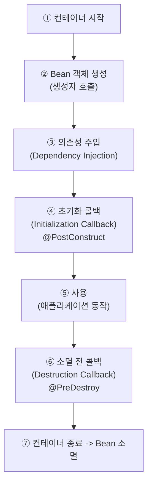

2026.10.13 (화) 저녁 7:30시 (비대면)

### 1. 자바 OOP
[[Encapsulation]]
[[Inheritance]]
[[Polymorphism]]
[[Abstraction]]

### 2. Bean
**Bean** = Spring 컨테이너 (Container)가 생성하고 관리하는 객체
==내가 `new`한 객체는 Bean이 아님== -> Spring이 관리하지 않아서 의존성 주입을 받을 수 없음

#### 2.1. 왜 Bean을 쓰나 (Why Beans)
클래스만으로도 동작은 하지만, 객체가 많아지면 만들고 연결하는 일이 문제가 됨

**Bean을 쓰면**
- 의존 객체를 먼저 만들어야 해서 **생성 순서**를 직접 관리
- 여러 곳에서 `new DataSource(...)`를 하면 연결 풀이 여러 개 생김 (공유 여부를 직접 결정)
- 생성자에 파라미터가 하나 추가되면 `new`가 있는 모든 곳을 수정 

```java
@Service
public class OrderService {
    public OrderService(OrderRepository repository, PaymentService payment, NotificationService notification) { ... }
} // 요런식으로 깔끔하게 괄호 넣어 주입 가능
```

#### 2.2. 만드는 방법
##### 방법 1. 우리가 빌드: 컴포넌트 스캔 (Component Scan) 
클래스에 어노테이션 (Annotation)만 붙이면 Spring이 시작할 때 찾아서 Bean으로 등록

```java
@Component
public class CardPayment implements PaymentService { ... }

@Service
public class OrderService {
    private final PaymentService paymentService;

    public OrderService(PaymentService paymentService) {   // 자동 주입
        this.paymentService = paymentService;
    }
}
```

- `@Service`(비즈니스 로직), `@Repository`(데이터 접근, DB 예외 변환도 해 줌), `@Controller`/`@RestController`(웹)도 전부 `@Component`의 특수한 형태, 역할을 이름으로 드러내려고 구분
- 스캔 범위: `@SpringBootApplication`이 붙은 클래스의 **패키지와 하위 패키지**만
    - 범위 밖 패키지의 클래스는 Bean 등록이 안 됨

##### 방법 2. 외부 빌드: @Configuration + @Bean (직접 등록, Java-based Configuration)
라이브러리 클래스 (소스 수정 불가 - 외부에서 미리 컴파일 됨)

```java
@Configuration
public class AppConfig {

    @Bean
    public PaymentService paymentService() {
        return new CardPayment();
    }

    @Bean
    public OrderService orderService(PaymentService paymentService) {   // 파라미터로 주입받음
        return new OrderService(paymentService);
    }
}
```

- 메소드 이름이 Bean 이름, 메소드가 반환한 객체가 Bean
- 파라미터로 의존 객체를 받으면 Spring이 알아서 넣어 줌

#### 2.3. Bean 이름 규칙

**기본 규칙**
- 컴포넌트 스캔: **클래스 이름의 첫 글자를 소문자로** (`CardPayment` -> `cardPayment`)
    - ==대문자로 2글자 이상 시작할 때==는 예외
- `@Bean` 메소드: **메소드 이름** (`paymentService()` -> `paymentService`)

**직접 지정할 수도 있음**
- `@Component("kakao")`, `@Bean(name = "kakao")` -> 이름 `kakao`
- 꼭 필요한 경우: 이름이 겹칠 때
    - Bean 이름에는 ==패키지가 고려되지 않아서== 클래스 이름이 겹치면 시작할 때 에러
    - 한쪽에 이름을 직접 줘서 해결 (`@Component("cardPayment2")`)
    - 겹침 범위: 프로젝트 전체 클래스가 아니라 **Bean으로 등록되는 것끼리** (스캔 범위 안의 `@Component` 계열 + `@Bean` 메소드 이름)

#### 2.4. 같은 타입 Bean이 여러 개일 때

**왜 생기나**
- Bean은 인터페이스가 아니라 ==구현 객체==
- 하지만 많은 서비스는 인터페이스(`PaymentService`)에 의존 ([[Abstraction]]) -> "`PaymentService`로 쓸 수 있는 Bean 아무거나 줘"라는 요청
- `CardPayment`, `KakaoPayment`가 둘 다 Bean이면 둘 다 후보 -> 고를 수 없어서 시작할 때 에러 (`NoUniqueBeanDefinitionException`)

**왜 인터페이스 상속?**
- 이점: 결제 방식을 바꿔도 `OrderService` 코드는 그대로 (새 구현체를 만들어 주입만 하면 됨)

```java
@Service
public class OrderService {                     // PaymentService만 알고 구현체는 모름 -> 수정 없음
    private final PaymentService paymentService;

    public OrderService(PaymentService paymentService) {
        this.paymentService = paymentService;
    }
}

@Component
public class KakaoPayment implements PaymentService { ... }   // 새 구현체만 추가
```

- 요청은 추상적인데 구체적이라 여러 개가 매칭됨
- `CardPayment`로 구체 타입을 요청하면 에러는 없어지지만 추상화의 이점도 사라짐
- ==`@Primary`==: 후보가 여러 개일 때 우선 주입할 Bean 하나를 지정 (후보 중 primary가 정확히 하나면 그게 주입됨)
- ==`@Qualifier`==: 주입받는 쪽에서 쓸 Bean을 이름 등으로 지정

### 3. Bean 범위 (Bean Scope)

Bean이 **얼마나 오래, 몇 개** 존재하는지를 정함

|스코프|설명|
|---|---|
|`singleton` 싱글톤 (기본)|Bean 정의 하나당 컨테이너 안에 **1개**, 모든 곳에서 같은 객체 공유|
|`prototype` 프로토타입|요청할 때마다 **새로 생성**|
|`request`|HTTP 요청 1번당 1개 (웹 환경)|
|`session`|HTTP 세션당 1개 (웹 환경)|
|`application`|웹 애플리케이션(ServletContext)당 1개|

```java
@Component
class A { }                          // 기본: singleton

@Component
@Scope("prototype")
class B { }                          // 매번 새 객체

ac.getBean(A.class) == ac.getBean(A.class)   // true  (같은 객체)
ac.getBean(B.class) == ac.getBean(B.class)   // false (다른 객체)
```

#### 중요: 싱글톤 Bean은 ==상태(필드 값) 없이 (무상태로)== 쓰는 것이 원칙
Spring 공식 문서: "상태가 있는 Bean에는 prototype, 상태가 없는 Bean에는 singleton 스코프를 쓴다"
모든 요청이 같은 객체를 공유하므로 여러 스레드 (Thread)가 동시에 값을 바꿀 수 있음
- `++count`는 읽기 -> 더하기 -> 쓰기 세 단계라서, 두 스레드가 동시에 실행하면 증가가 한 번 사라질 수 있음

```java
@Service
public class CounterService {
    private int count = 0;                   // 위험: 모두가 공유하는 값

    public int increase() { return ++count; }
}
```

**잠그면 되지 않나? -> `synchronized`**
- 화장실 문 잠그기: 한 스레드가 들어가 있는 동안 다른 스레드는 밖에서 기다림

```java
public synchronized int increase() { return ++count; }
```

- 하지만 스레드가 줄을 서서 느려지고 코드도 복잡해짐 (`AtomicInteger`처럼 `synchronized` 없이도 스레드 간섭을 막는 클래스도 있음)
- 그래서 애초에 상태를 두지 않는 게 낫다 -> 싱글톤은 **무상태 (Stateless)** 로 설계: 값은 지역 변수나 파라미터로 처리

### 4. Bean Lifecycle

Spring 컨테이너가 관리하는 bean 생애 주기, 싱글톤 Bean 기준




##### 예제
- 의존성 주입이 다 끝난 뒤 실행할 작업(연결 맺기, 캐시 로딩 등)은 생성자가 아니라 `@PostConstruct`에, 정리 작업은 `@PreDestroy`에 작성

```java
public class NetworkClient {

    public NetworkClient() {
        System.out.println("1. 생성자 호출");
    }

    @PostConstruct                     // 주입이 끝난 뒤 호출
    public void connect() {
        System.out.println("2. 초기화: 서버에 연결");
    }

    public void send(String msg) {     // 평소에 쓰는 메소드
        System.out.println("3. 사용: " + msg + " 전송");
    }

    @PreDestroy                        // 컨테이너가 닫히기 직전 호출
    public void close() {
        System.out.println("4. 소멸 전: 연결 종료");
    }
}

@Configuration
class LifeCycleConfig {

    @Bean
    public NetworkClient networkClient() {
        return new NetworkClient();
    }
}
```

```java
AnnotationConfigApplicationContext ac = new AnnotationConfigApplicationContext(LifeCycleConfig.class);   // 컨테이너 시작

NetworkClient client = ac.getBean(NetworkClient.class);
client.send("hello");

ac.close();    // 컨테이너를 닫아야 @PreDestroy가 호출됨
```

```
1. 생성자 호출                <- 컨테이너가 시작될 때
2. 초기화: 서버에 연결         <- 컨테이너가 시작될 때 (의존성 주입 직후)
3. 사용: hello 전송           <- client.send()를 호출할 때
4. 소멸 전: 연결 종료          <- ac.close()를 호출할 때
```

- 싱글톤 Bean은 **컨테이너가 시작될 때** 만들어짐 (`getBean`을 호출할 때가 아님)
- Spring Boot 3 이상은 `jakarta.annotation.PostConstruct` (Boot 2는 `javax.annotation`)

### 토론 질문

1. **왜 Bean은 기본적으로 하나만 만들어서 모두가 함께 쓸까? (싱글톤, Singleton)**
    - 생각해볼 점: 요청이 올 때마다 객체를 새로 만들면 어떻게 될까? / 여러 요청이 같은 객체의 값을 동시에 바꾸면 어떤 문제가 생길까?
2. **`OrderService`가 `CardPayment`가 아니라 `PaymentService`(인터페이스)에 의존하면 어떤 점이 좋을까?**
    - 생각해볼 점: 결제 방식을 카카오페이로 바꿀 때 `OrderService`를 고쳐야 할까? / 이것이 다형성 (Polymorphism)과 어떤 관련이 있을까?

### 퀴즈

1. (OOP) 다음 중 캡슐화 (Encapsulation)를 가장 잘 적용한 것은?
	1. 모든 필드를 `public`으로 두고 어디서든 직접 접근한다
	2. 필드를 `private`으로 두고, 검증 로직이 있는 메소드로만 값을 변경한다
	3. 모든 필드에 아무 로직 없는 public setter를 만든다
	4. 부모 클래스를 상속받아 필드를 그대로 사용한다

   **2번.** 필드를 숨기고 의미 있는 메소드로만 변경해야 캡슐화. 3번처럼 로직 없는 setter는 필드를 public으로 연 것과 크게 다르지 않음

2. (Bean 생성) 소스를 수정할 수 없는 외부 라이브러리의 클래스를 Bean으로 등록하려면 어떤 방법을 써야 할까?
	1. 클래스에 `@Component`를 붙인다
	2. `@Configuration` 클래스에서 `@Bean` 메소드로 등록한다
	3. 클래스 이름을 `~Service`로 바꾼다
	4. `@Scope("prototype")`을 붙인다

   **2번.** 소스를 못 고치는 클래스에는 `@Component`를 붙일 수 없으니 `@Bean`으로 직접 등록

3. (라이프사이클, Lifecycle) 싱글톤 Bean의 올바른 흐름은?
	1. 의존성 주입 -> 객체 생성 -> `@PostConstruct` -> 사용 -> `@PreDestroy`
	2. 객체 생성 -> `@PostConstruct` -> 의존성 주입 -> 사용 -> `@PreDestroy`
	3. 객체 생성 -> 의존성 주입 -> `@PostConstruct` -> 사용 -> `@PreDestroy`
	4. 객체 생성 -> 의존성 주입 -> 사용 -> `@PostConstruct` -> `@PreDestroy`

   **3번.** 생성자로 객체 생성 -> 의존성 주입 -> 초기화 콜백(`@PostConstruct`) -> 사용 -> 소멸 전 콜백(`@PreDestroy`)

4. (스코프, Scope) 아래 코드의 (가), (나) 결과는?

   ```java
   @Component
   class A { }                                 // 기본 스코프

   @Component
   @Scope("prototype")
   class B { }

   System.out.println(ac.getBean(A.class) == ac.getBean(A.class));   // (가)
   System.out.println(ac.getBean(B.class) == ac.getBean(B.class));   // (나)
   ```

   **(가) true, (나) false.** 싱글톤은 항상 같은 객체, 프로토타입은 요청마다 새로 생성

### 참고 링크
- Spring, Classpath Scanning and Managed Components: https://docs.spring.io/spring-framework/reference/core/beans/classpath-scanning.html
- Spring, Bean Scopes: https://docs.spring.io/spring-framework/reference/core/beans/factory-scopes.html
- Spring, Customizing the Nature of a Bean (Lifecycle Callbacks): https://docs.spring.io/spring-framework/reference/core/beans/factory-nature.html
- Spring, AnnotationBeanNameGenerator Javadoc: https://docs.spring.io/spring-framework/docs/current/javadoc-api/org/springframework/context/annotation/AnnotationBeanNameGenerator.html
- Oracle, Thread Interference: https://docs.oracle.com/javase/tutorial/essential/concurrency/interfere.html

### 더 알아볼 내용 (질문)

- Annotations 설명
- 왜 외부 코드에는 @Component를 못 붙일까? -> 해결

