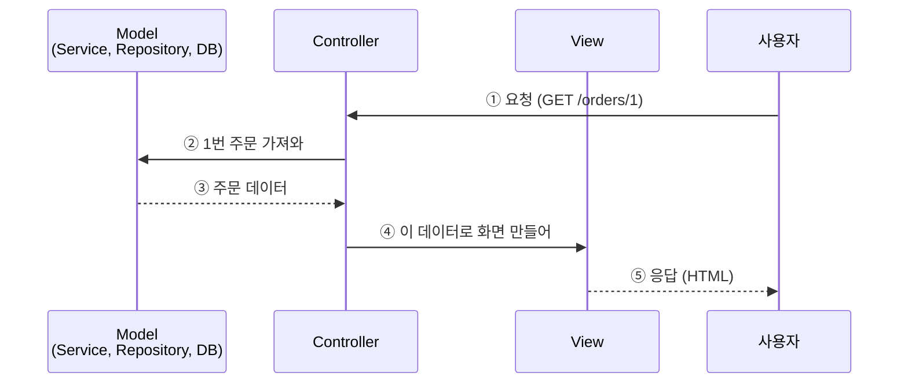
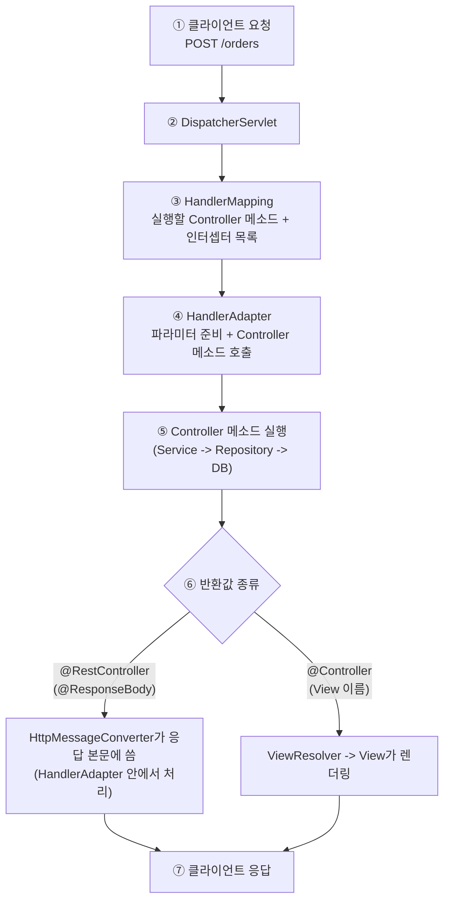

2026.10.20 (화) 저녁 7시 반 (비대면)

### 1. MVC 패턴
**MVC** = 프로그램을 **Model(데이터·업무) / View(화면) / Controller(요청 처리)** 세 역할로 나누는 설계 방식
- [[Basics_W1]]에서 본 역할 층(Controller -> Service -> Repository)과 같은 아이디어를 웹 화면 기준으로 부르는 이름
- MVC는 설계 패턴(개념)이고, **Spring MVC**는 Spring의 여러 모듈 중 웹 요청 처리를 담당하며 이 패턴을 구현한 것 -> [[Spring]]

#### 1.1. 세 역할
| 역할 | 하는 일 | 비유 (식당) | Spring에서 |
|---|---|---|---|
| **Model** | 데이터와 업무 규칙. 화면이 무엇을 보여줄지 담고 있음 | 주방 (요리 + 재료) | Service, Repository, Entity, DTO |
| **View** | 사용자에게 보이는 화면. Model의 값을 꺼내 그리기만 함 | 완성된 요리를 담은 접시 | HTML 템플릿 (Thymeleaf 등). REST에서는 서버에 없고 클라이언트(React 등)가 담당 |
| **Controller** | 요청을 받아 Model에 일을 시키고, 결과를 어떤 View로 보여줄지 정함 | 홀 직원 | `@Controller`, `@RestController` |

- Controller는 직접 요리(업무 처리)하지 않고 **Model에 위임**, View는 직접 데이터를 계산하지 않고 **받은 값을 보여주기만** 함

#### 1.2. 동작 흐름

- 위에서 아래로 시간 순서, 가운데 Controller가 요청을 받아 Model과 View를 이어 줌
- 이 그림은 서버가 HTML을 만드는 전통 MVC 기준 (REST API는 1.3)

#### 1.3. 전통 MVC vs REST API
서버가 **화면(HTML)까지 만들어 주는가**에 따라 View의 모습이 달라짐

| | 전통 MVC | REST API |
|---|---|---|
| 어노테이션 | `@Controller` | `@RestController` (= `@Controller` + `@ResponseBody`) |
| Controller 반환값 | View 이름 (`"order-detail"`) | 객체 (`OrderResponse`) |
| 응답 | 서버가 만든 HTML | JSON 데이터 |
| 화면 그리는 곳 | 서버 (View 템플릿) | 클라이언트 (React, 앱 등) |

- Controller는 요청 접수만 하고, 업무는 Service에 위임한다. [[Basics_W1]]

### 2. DispatcherServlet 요청 처리 흐름
-  모든 요청이 **DispatcherServlet** 한 곳으로 들어온 뒤 알맞은 곳으로 나뉨 (**Front Controller 패턴**)
- 요청마다 URL별 서블릿을 따로 두지 않고 입구를 하나로 모아서, 공통 처리를 한곳에서 할 수 있음
- 충청도 택배 다 옥천 HUB에 모이는 것 처럼!

#### 2.1. 구성 요소
| 구성 요소 | 하는 일 |
|---|---|
| **DispatcherServlet** | 요청을 가장 먼저 받고, 아래 구성 요소들에게 일을 나눠 주는 총괄 |
| **HandlerMapping** | URL + HTTP 메소드(`@GetMapping`, `@PostMapping`)로 **실행할 Controller 메소드를 찾음** |
| **HandlerAdapter** | 찾은 메소드를 **실제로 호출**. 어노테이션 해석 같은 호출 세부 사항을 DispatcherServlet이 몰라도 되게 해 줌. `@RequestMapping` 메소드는 `RequestMappingHandlerAdapter`가 담당 (파라미터 값 준비, 반환값 처리) |
| **Controller** | 우리가 작성하는 부분. 업무는 Service에 위임 |
| **ViewResolver** | (전통 MVC) Controller가 반환한 논리적 View 이름을 실제 `View`로 연결. 그 `View`가 응답을 렌더링 |
| **HttpMessageConverter** | `@RequestBody`의 요청 본문을 객체로 변환. `@ResponseBody`(`@RestController` 포함) 반환 객체를 응답 본문으로 변환 (JSON 등) |
| **HandlerExceptionResolver** | 예외를 처리 (예외 처리기, HTML 에러 화면 등으로 연결) |

#### 2.2. 흐름



- 우리가 쓰는 건 `@RestController`, `@RequestMapping` 같은 어노테이션뿐, 나머지는 DispatcherServlet이 알아서 처리
- Spring Boot는 DispatcherServlet을 자동 설정으로 등록해 줌 [[Basics_W1]]
- 예외가 던져지면 정상 흐름에서 벗어나 예외 처리기로 넘어감 (4번)

#### 2.3. Controller 코드와 요청 값 받는 법
```java
@RestController
@RequestMapping("/orders")                        // 공통 URL
public class OrderController {

    private final OrderService orderService;

    public OrderController(OrderService orderService) {   // 생성자 주입 [[Basics_W2]]
        this.orderService = orderService;
    }

    @PostMapping                                          // POST /orders
    public OrderResponse create(@RequestBody OrderRequest request) {   // JSON -> OrderRequest
        return orderService.create(request);                           // OrderResponse -> JSON
    }

    @GetMapping("/{id}")                                  // GET /orders/1
    public OrderResponse find(@PathVariable Long id) {
        return orderService.find(id);
    }
}
```

| 어노테이션 | 요청에서 값을 꺼내는 곳 | 예 |
|---|---|---|
| `@PathVariable` | URL 경로의 일부 | `/orders/1` -> `id = 1` |
| `@RequestParam` | 쿼리 문자열 | `/orders?status=PAID` -> `status = "PAID"` |
| `@RequestBody` | 요청 본문(JSON) 전체 | `{"productName": "pen", "quantity": 2}` -> 객체 |

- Controller는 `@Component`의 한 종류라 Bean으로 등록되고, `OrderService`는 DI로 주입됨 [[Basics_W3]]

### 3. 요청 검증 (Validation)
클라이언트가 보낸 값은 믿을 수 없으니 **Controller 입구에서 먼저 검사**
- 의존성: `spring-boot-starter-validation`
- 요청 DTO 필드에 규칙을 선언하고, Controller 파라미터에 `@Valid`를 붙임

```java
public record OrderRequest(
    @NotBlank String productName,          // 빈 문자열, 공백 불가
    @Min(1) int quantity                   // 1 이상
) { }
```

```java
@PostMapping
public OrderResponse create(@Valid @RequestBody OrderRequest request) { ... }
```

- 검증에 실패하면 **Controller 메소드가 실행되기 전에** `MethodArgumentNotValidException`이 발생 (2.2의 ④, HandlerAdapter가 요청 값을 파라미터로 만드는 단계)
- 자주 쓰는 어노테이션

| 어노테이션 | 의미 |
|---|---|
| `@NotNull` | null 불가 |
| `@NotBlank` | null, 빈 문자열, 공백만 있는 문자열 불가 (문자열 전용) |
| `@NotEmpty` | null, 빈 문자열/빈 컬렉션 불가 |
| `@Min` / `@Max` | 최솟값 / 최댓값 |
| `@Size` | 길이 / 크기 범위 |
| `@Email` | 이메일 형식 |

- 검증 위치
    - 입력 형식 검증 (비었는지, 범위): DTO + `@Valid`
    - 업무 규칙 검증 (재고가 있는지 등): Service

### 4. 전역 예외 처리 (`@RestControllerAdvice`)
예외가 나면 Controller마다 `try-catch` 하지 않고 **한곳에서 모아서** 응답으로 바꿈

```java
@RestControllerAdvice
public class GlobalExceptionHandler {

    @ExceptionHandler(MethodArgumentNotValidException.class)       // 검증 실패
    public ResponseEntity<ErrorResponse> handleValidation(MethodArgumentNotValidException e) {
        return ResponseEntity.badRequest()
                .body(new ErrorResponse("INVALID_REQUEST", "요청 값이 올바르지 않습니다"));
    }

    @ExceptionHandler(IllegalArgumentException.class)              // 직접 던진 예외
    public ResponseEntity<ErrorResponse> handleIllegalArgument(IllegalArgumentException e) {
        return ResponseEntity.badRequest()
                .body(new ErrorResponse("BAD_REQUEST", e.getMessage()));
    }
}

public record ErrorResponse(String code, String message) { }
```

- `@RestControllerAdvice`: 모든 Controller에 적용되는 예외 처리 클래스 (`@ControllerAdvice` + `@ResponseBody`)
- `@ExceptionHandler(예외 타입)`: 그 예외가 발생했을 때 실행할 메소드
- 효과
    - 에러 응답이 **전부 같은 모양**이 됨 (클라이언트가 처리하기 쉬움)
    - Controller와 Service는 정상 흐름에만 집중
    - HTTP 상태 코드(400, 404, 500 등)를 한곳에서 관리

### 5. 어노테이션 (Annotation)
코드에 `@이름`으로 붙이는 **추가 정보(메타데이터)**. 
어노테이션 자체는 아무 동작도 하지 않고, **그걸 읽는 쪽**이 보고 동작함

| 읽는 쪽 | 예 | 하는 일 |
|---|---|---|
| 컴파일러 | `@Override` | 부모 메소드를 재정의했는지 컴파일할 때 검사 |
| Spring | `@Component`, `@Bean`, `@RestController` | 시작할 때 읽어서 Bean 등록, URL 연결 |
| 검증 라이브러리 | `@NotBlank`, `@Min` | `@Valid`가 있을 때 값을 검사 |

- 값을 줄 수 있음: `@RequestMapping("/orders")`, `@Min(1)`
- 직접 만들 수도 있음 (`@interface`), 만들 때는 두 가지를 정함
    - `@Target`: 어디에 붙일 수 있나 (클래스, 메소드, 필드 등)
    - `@Retention`: 언제까지 남나 (`RUNTIME`이면 실행 중에 Spring이 읽을 수 있음)

### 토론 질문
1. **왜 화면(View), 요청 처리(Controller), 업무(Model)를 나눠서 만들까?**
    - 생각해볼 점: 한 클래스에 다 넣으면 화면만 바꿀 때 어떤 일이 생길까? / REST API에서는 View가 무엇으로 바뀌었을까?
2. **왜 검증을 Service 안이 아니라 Controller 입구(`@Valid`)에서 할까?**
    - 생각해볼 점: 잘못된 값이 Service, DB까지 들어가면 어떤 문제가 생길까? / 어떤 검증은 Service에서 해야 할까?
3. **예외를 Controller마다 `try-catch` 하지 않고 `@RestControllerAdvice`로 모으면 어떤 점이 좋을까?**
    - 생각해볼 점: 에러 응답 형식이 제각각이면 클라이언트는 어떻게 될까? / ==예외를 처리하지 않고 두면 클라이언트는 무엇을 받을까?==
      **예외 처리 하지 않으면 기본 서버 오류 500으로 나가고, 실제로 어떤 오류가 났는지 알기 어려움**

### 퀴즈
1. (MVC) 역할과 설명이 올바르게 짝지어진 것은?
	1. Model - 요청을 받아 어떤 화면을 보여줄지 정한다
	2. View - 데이터와 업무 규칙을 직접 처리한다
	3. Controller - 요청을 받아 Model에 일을 시키고 결과를 View로 넘긴다
	4. Controller - DB에 직접 SQL을 실행한다

   **3번.** Controller는 요청 접수와 연결만 담당. 업무와 데이터는 Model, 화면 그리기는 View의 역할

2. (@Controller vs @RestController) 설명으로 맞는 것은?
	1. `@RestController`는 반환한 문자열을 항상 View 이름으로 해석한다
	2. `@RestController`는 `@Controller`에 `@ResponseBody`가 합쳐진 것으로, 반환 객체를 JSON 응답으로 보낸다
	3. `@Controller`는 JSON만 반환할 수 있다
	4. 둘은 완전히 같아서 구분할 필요가 없다

   **2번.** `@Controller`는 View 이름을 반환해 HTML을 만들 때, `@RestController`는 데이터(JSON)를 바로 응답할 때 사용

3. (DispatcherServlet) 요청이 들어왔을 때 어떤 Controller 메소드를 실행할지 찾는 역할은?
	1. HandlerAdapter
	2. HandlerMapping
	3. HttpMessageConverter
	4. DispatcherServlet이 직접 코드로 하드코딩

   **2번.** HandlerMapping이 URL과 HTTP 메소드로 메소드를 찾고, HandlerAdapter가 그것을 호출함

4. (요청 값) `GET /orders/5`에서 `5`를 메소드 파라미터로 받을 때 쓰는 어노테이션은?
	1. `@RequestBody`
	2. `@RequestParam`
	3. `@PathVariable`
	4. `@Valid`

   **3번.** URL 경로의 일부는 `@PathVariable`. `@RequestParam`은 `?key=value` 쿼리 문자열, `@RequestBody`는 본문(JSON)

5. (Validation) `@NotBlank`에 대한 설명으로 맞는 것은?
	1. 숫자 필드의 최솟값을 정한다
	2. null, 빈 문자열, 공백만 있는 문자열을 허용하지 않는다
	3. 컬렉션이 비어 있으면 안 된다
	4. Controller 파라미터에 붙이면 자동으로 검증된다

   **2번.** 문자열 전용. Controller에서 검증이 실행되려면 파라미터에 `@Valid`도 필요함

6. (예외 처리, O/X) `@RestControllerAdvice` 클래스를 만들면 모든 Controller에서 발생한 예외를 한곳에서 처리할 수 있다.
   **O.** `@ExceptionHandler`로 예외 타입별 응답을 정의함

### 참고 링크
- Spring, DispatcherServlet: https://docs.spring.io/spring-framework/reference/web/webmvc/mvc-servlet.html
- Spring, Special Bean Types: https://docs.spring.io/spring-framework/reference/web/webmvc/mvc-servlet/special-bean-types.html
- Spring, Processing Sequence: https://docs.spring.io/spring-framework/reference/web/webmvc/mvc-servlet/sequence.html
- Spring, @RequestBody: https://docs.spring.io/spring-framework/reference/web/webmvc/mvc-controller/ann-methods/requestbody.html
- Spring, Controller Advice: https://docs.spring.io/spring-framework/reference/web/webmvc/mvc-controller/ann-advice.html

### 더 알아볼 내용 (질문)

