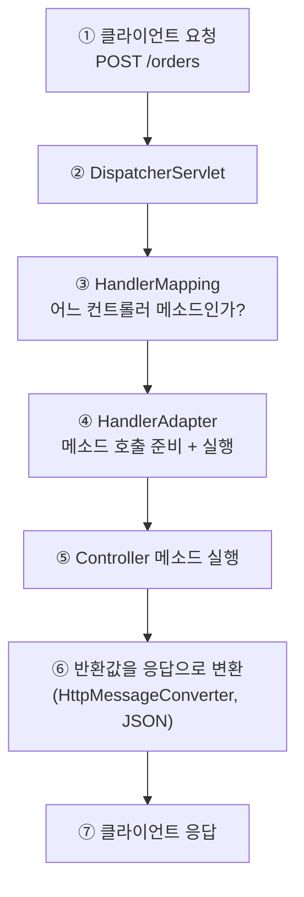

2026.10.20 저녁 7시 반(비대면)

### 1. DispatcherServlet 요청 처리 흐름

Spring MVC = 웹 요청을 컨트롤러 메소드에 연결해 주는 구조
모든 요청이 **DispatcherServlet** 한 곳으로 들어온 뒤 알맞은 곳으로 나눠 줌 (Front Controller 패턴)

- 비유: 식당 홀 매니저. 손님(요청)이 오면 어느 담당자(컨트롤러)에게 보낼지 정해 주고, 결과를 받아 손님에게 돌려줌



| 단계 | 하는 일 |
|---|---|
| HandlerMapping | URL + HTTP 메소드(`@GetMapping`, `@PostMapping`)로 실행할 컨트롤러 메소드를 찾음 |
| HandlerAdapter | 찾은 메소드를 실제로 호출. 요청 값을 메소드 파라미터에 넣어 줌 |
| HttpMessageConverter | 요청 JSON -> 객체 (`@RequestBody`), 반환 객체 -> 응답 JSON (`@RestController`) |

- 우리가 쓰는 건 `@RestController`와 `@RequestMapping`류 어노테이션뿐, 나머지는 DispatcherServlet이 알아서 처리
- Spring Boot는 DispatcherServlet을 자동 설정으로 등록해 줌 ([[Basics_W1]])

```java
@RestController
@RequestMapping("/orders")
public class OrderController {

    @PostMapping
    public OrderResponse create(@RequestBody OrderRequest request) {   // JSON -> OrderRequest
        return orderService.create(request);                           // OrderResponse -> JSON
    }
}
```

- 예외가 던져지면 정상 흐름에서 벗어나 예외 처리기로 넘어감 (아래 3번)

### 2. 요청 검증 (Validation)

클라이언트가 보낸 값은 믿을 수 없으니 **컨트롤러 입구에서 먼저 검사**

- 의존성: `spring-boot-starter-validation`
- 요청 DTO 필드에 규칙을 선언하고, 컨트롤러 파라미터에 `@Valid`를 붙임

```java
public record OrderRequest(
    @NotBlank String productName,          // 빈 문자열, 공백 불가
    @Min(1) int quantity                   // 1 이상
) { }
```

```java
@PostMapping
public OrderResponse create(@Valid @RequestBody OrderRequest request) { ... }
```

- 검증에 실패하면 **컨트롤러 메소드가 실행되기 전에** `MethodArgumentNotValidException`이 발생
- 자주 쓰는 어노테이션

| 어노테이션 | 의미 |
|---|---|
| `@NotNull` | null 불가 |
| `@NotBlank` | null, 빈 문자열, 공백만 있는 문자열 불가 (문자열 전용) |
| `@NotEmpty` | null, 빈 문자열/빈 컬렉션 불가 |
| `@Min` / `@Max` | 최솟값 / 최댓값 |
| `@Size` | 길이 / 크기 범위 |
| `@Email` | 이메일 형식 |

- 검증 위치 정리
    - 입력 형식 검증(비었는지, 범위): DTO + `@Valid`
    - 업무 규칙 검증(재고가 있는지 등): 서비스 계층

### 3. 전역 예외 처리 (`@RestControllerAdvice`)

예외가 나면 컨트롤러마다 `try-catch` 하지 말고 **한곳에서 모아서** 응답으로 바꿈

```java
@RestControllerAdvice
public class GlobalExceptionHandler {

    @ExceptionHandler(MethodArgumentNotValidException.class)       // 검증 실패
    public ResponseEntity<ErrorResponse> handleValidation(MethodArgumentNotValidException e) {
        return ResponseEntity.badRequest()
                .body(new ErrorResponse("INVALID_REQUEST", "요청 값이 올바르지 않습니다"));
    }

    @ExceptionHandler(IllegalArgumentException.class)              // 직접 던진 예외
    public ResponseEntity<ErrorResponse> handleIllegalArgument(IllegalArgumentException e) {
        return ResponseEntity.badRequest()
                .body(new ErrorResponse("BAD_REQUEST", e.getMessage()));
    }
}

public record ErrorResponse(String code, String message) { }
```

- `@RestControllerAdvice`: 모든 컨트롤러에 적용되는 예외 처리 클래스 (`@ControllerAdvice` + `@ResponseBody`)
- `@ExceptionHandler(예외 타입)`: 그 예외가 발생했을 때 실행할 메소드
- 효과
    - 에러 응답 형식이 **전부 같은 모양**이 됨 (클라이언트가 처리하기 쉬움)
    - 컨트롤러와 서비스는 정상 흐름에만 집중
    - HTTP 상태 코드(400, 404, 500 등)를 한곳에서 관리

### 4. 어노테이션 (Annotation) 간략 정리

코드에 `@이름`으로 붙이는 **추가 정보(메타데이터)**. 어노테이션 자체는 아무 동작도 하지 않고, **그걸 읽는 쪽**이 보고 동작함

- 읽는 쪽에 따라 역할이 달라짐

| 읽는 쪽 | 예 | 하는 일 |
|---|---|---|
| 컴파일러 | `@Override` | 부모 메소드를 재정의했는지 컴파일할 때 검사 |
| Spring | `@Component`, `@Bean`, `@RestController` | 시작할 때 읽어서 Bean 등록, URL 연결 |
| 검증 라이브러리 | `@NotBlank`, `@Min` | `@Valid`가 있을 때 값을 검사 |

- 이 주차에서 만난 어노테이션도 같은 원리: `@RestController`를 보고 Bean으로 등록, `@PostMapping`을 보고 URL에 연결, `@Valid`를 보고 검증, `@ExceptionHandler`를 보고 예외 처리기로 등록
- 값을 줄 수 있음: `@RequestMapping("/orders")`, `@Min(1)`
- 직접 만들 수도 있음 (`@interface`), 만들 때는 두 가지를 정함
    - `@Target`: 어디에 붙일 수 있나 (클래스, 메소드, 필드 등)
    - `@Retention`: 언제까지 남나 (`RUNTIME`이면 실행 중에 Spring이 읽을 수 있음)

### 토론 질문 (핵심 2개)

1. **왜 검증을 서비스 안이 아니라 컨트롤러 입구(`@Valid`)에서 할까?**
    - 생각해볼 점: 잘못된 값이 서비스, DB까지 들어가면 어떤 문제가 생길까? / 어떤 검증은 서비스에서 해야 할까?
2. **예외를 컨트롤러마다 `try-catch` 하지 않고 `@RestControllerAdvice`로 모으면 어떤 점이 좋을까?**
    - 생각해볼 점: 에러 응답 형식이 제각각이면 클라이언트는 어떻게 될까? / 예외를 처리하지 않고 두면 클라이언트는 무엇을 받을까?

### 퀴즈

**Q1. (DispatcherServlet) 요청이 들어왔을 때 어떤 컨트롤러 메소드를 실행할지 찾는 역할은?**

1. HandlerAdapter
2. HandlerMapping
3. HttpMessageConverter
4. DispatcherServlet이 직접 코드로 하드코딩

- 정답

    **Q1: 2번.** HandlerMapping이 URL과 HTTP 메소드로 메소드를 찾고, HandlerAdapter가 그것을 호출함

**Q2. (Validation) `@NotBlank`에 대한 설명으로 맞는 것은?**

1. 숫자 필드의 최솟값을 정한다
2. null, 빈 문자열, 공백만 있는 문자열을 허용하지 않는다
3. 컬렉션이 비어 있으면 안 된다
4. 컨트롤러 파라미터에 붙이면 자동으로 검증된다

- 정답

    **Q2: 2번.** 문자열 전용. 컨트롤러에서 검증이 실행되려면 파라미터에 `@Valid`도 필요함

**Q3. (예외 처리) 아래 설명 중 맞는 것은? (O/X)**

`@RestControllerAdvice` 클래스를 만들면 모든 컨트롤러에서 발생한 예외를 한곳에서 처리할 수 있다.

- 정답

    **Q3: O.** `@ExceptionHandler`로 예외 타입별 응답을 정의함

### 더 알아볼 내용 (질문)

