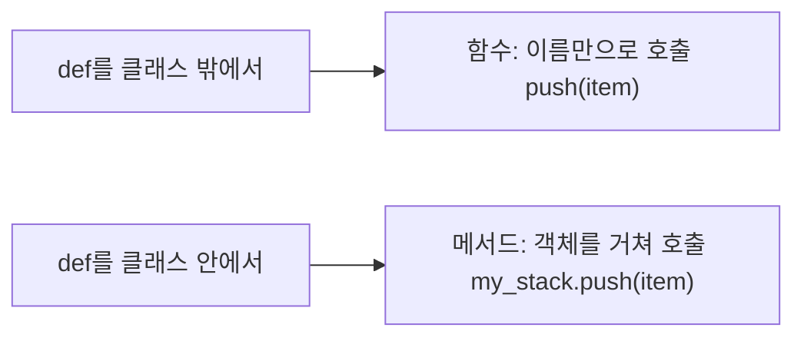

함수는 직접 만든 붕어빵 틀(`def`). 클래스는 데이터와 기능을 한 봉지로 묶은 설계도, 객체(instance)는 그 설계도로 만든 실체



### 원리
- 파이썬은 인터프리터 언어: 한 줄씩 실행하며 넘어가 실행 중간에 에러가 남. 수정은 편하고 느림. 컴파일 언어(Java 등)는 한 번 쭉 번역해 실행 파일을 만들어 빠르지만 수정이 느림
- 객체 지향: 클래스로 데이터와 기능을 묶어 청사진을 그리고, 객체를 만들어 그 능력을 적용
- 함수 vs 메서드
  - 함수: 클래스에 속하지 않고 어디서든 이름으로 호출 (`print()`, `len()`, `sorted()`)
  - 메서드: 클래스 안에 정의되고 그 클래스로 만든 객체를 통해서만 호출 (`list.sort()`, `str.split()`). 첫 인자는 관례상 `self`
  - 메서드도 넓은 의미에선 함수라 `key` 같은 옵션을 똑같이 받음 (`sorted(x, key=len)`, `x.sort(key=len)`)
- lambda: 이름 없는 일회용 함수. `lambda 매개변수: 결과값`. `def add_one(x): return x + 1`과 `lambda x: x + 1`이 같음
  - 식은 한 줄 하나만. 복잡한 if·for는 못 넣음, 이름이 없어 재사용·에러 추적이 어려움
- key: 비교하기 직전에 각 원소에 적용할 기준 함수. 원소 자체는 안 바뀌고 그 결과값으로 비교 ([[정렬]])
  - 함수 이름만 넣음. `key=len`, `key=str.lower`(대소문자 무시), `key=abs`. `len()`처럼 괄호를 붙이지 않음
  - key를 받는 것: `sorted()`, `list.sort()`, `max()`, `min()`
```python
nums = [-10, 2, 5, -1]
print(max(nums))           # 5
print(max(nums, key=abs))  # -10 (절댓값으로 보면 가장 큼)
```

### 활용
- 정렬 기준이 단순하면 lambda로 바로: `sorted(students, key=lambda x: x[1])`. 여러 기준은 튜플, 내림차순 섞이면 `-x[1]` ([[정렬]], [[우선순위_규칙]])
- 입력을 받으며 바로 가공: `list(map(lambda x: int(x) - 1, input()))`로 int 변환 + 인덱스 보정
- 가변 인자 (함수 정의 쪽에서 묶기). `*args`가 `**kwargs`보다 앞

| | `*args` | `**kwargs` |
|---|---|---|
| 묶이는 모양 | 튜플 | dict |
| 접근 | `args[0]` | `kwargs['name']` |
| 호출할 때 | 값을 콤마로 나열, 또는 `*iterable` | `key=값`으로 나열, 또는 `**dict` |
| 용도 | 인자 개수가 유동적 | 옵션·설정값을 이름으로 |
```python
def func1(a, b, *args):
    print(a, b, args)    # func1(1, 2, 3, 4, 5) → 1 2 (3, 4, 5)

def connect(**kwargs):
    timeout = kwargs.get('timeout', 30)  # 옵션이 없으면 기본값
    retry = kwargs.get('retry', 3)
    print(timeout, retry)  # connect(timeout=10) → 10 3
```
- 함수를 감싸는 함수(decorator): 어떤 인자가 올지 모르니 `*args, **kwargs`로 통째로 받아 그대로 전달
```python
def logger(func):
    def wrapper(*args, **kwargs):
        print(f"함수 {func.__name__} 실행 중...")
        return func(*args, **kwargs)
    return wrapper
```
- 상속: 부모가 받는 인자를 일일이 안 적고 `super().__init__(*args, **kwargs)`로 넘김
- 클래스: `__init__`은 객체를 만들 때(`Robot("알파")`) 딱 한 번 자동 실행되어 값을 `self.name`처럼 내부에 저장. 일반 메서드는 `self`로 저장된 값을 꺼내 씀
  - 객체마다 따로 동작. bot1이 움직여 배터리가 줄어도 bot2는 100 그대로
  - 변하지 않는 고유 속성(이름, 모델명, 초기 용량)은 `__init__`, 행동할 때마다 바뀌는 조건(이동 거리, 인사 대상)은 메서드 매개변수
- 스택·큐를 클래스로 묶으면 함수가 메서드가 되어 `s1.push(10)`처럼 덩어리로 호출 ([[Stack]])

### 주의
- `key=len()`처럼 괄호를 붙이면 함수 실행 결과가 들어가 에러
- 함수 인자로 넘긴 리스트를 함수 안에서 고치면 밖도 바뀜. 재할당이면 안 바뀜 ([[복사와_참조]])
- `*args`는 위치 인자만 받음. 이름을 붙여 넘기면 `**kwargs` 쪽으로
- 전역 변수와 함수의 관계는 [[변수_범위]]

관련: [[변수_범위]], [[복사와_참조]], [[컴프리헨션과_언패킹]], [[정렬]]
